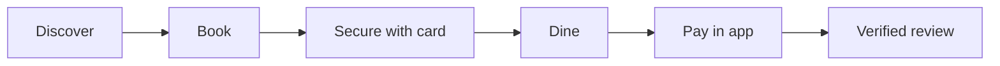

# GoMingle

**Social Dining & Restaurant Booking Platform**
*Discover restaurants. Secure tables. Create memories.*


---

## Table of Contents

- [Overview](#overview)
- [Team](#team)
- [Problem Statement](#problem-statement)
- [Core Flow](#core-flow)
- [Products](#products)
- [Technology Stack](#technology-stack)
- [Delivery Plan](#delivery-plan)
- [Scope Estimate](#scope-estimate)
- [Repository Structure](#repository-structure)
- [Documentation Index](#documentation-index)
- [Key Assumptions and Dependencies](#key-assumptions-and-dependencies)
- [Contributing](#contributing)

---

## Overview

GoMingle is a social dining and restaurant booking platform for the Karachi food and beverage market. It combines curated restaurant discovery, group coordination and verified post-dining reviews, and it gives restaurants a way to enforce booking commitments.

This repository is the single source of truth for the project: requirement analysis, formal documentation, design assets and source code. It was prepared by **Team GoMingle** as part of the **NUCES MS Practicum**.

## Team

**Team GoMingle**, NUCES MS Practicum

| Name | Roll No. |
|---|---|
| Syed Rameez Ali | 25K-8302 |
| Rahim Ahmed Khan | 25K-8303 |
| Sheikh Raees Raza | 25K-8323 |

**Current phase: Development.** Requirements and specifications are complete; the `Development` folders are where active work now happens.

## Problem Statement

Karachi has over 2,600 licensed restaurants, yet the sector has an unresolved structural gap:

- **Restaurants cannot enforce booking commitments.** Industry estimates put the no-show rate at 5-20% of reservations. With an average cover of PKR 2,500-4,000, the annual cost runs into hundreds of millions of PKR.
- **Diners lack a trusted, social-first platform.** There is no single place combining curated discovery, group coordination and reviews that cannot be faked.

## Core Flow

The MVP is deliberately focused on one end-to-end journey:



| Capability | How it works |
|---|---|
| **Booking commitment** | A card pre-authorisation hold is placed at booking and captured at the 24-hour confirmation trigger. No-show penalties follow in Phase 2. |
| **Platform fee** | Post-dining in-app payment is split to the restaurant after an admin-configured platform commission on every confirmed booking. |
| **Verified reviews** | Reviews unlock only after a booking reaches *Completed* status, so the review corpus cannot be faked. |
| **Phase 2 data foundation** | Every booking, arrival and review builds the dataset needed for AI analytics and dynamic pricing. |

## Products

GoMingle is delivered as three products that share one backend:

| Product | Audience | Platform |
|---|---|---|
| **Mingler App** | Diners | Flutter, iOS and Android |
| **Partner Portal** | Restaurant partners | Web (React.js) |
| **Admin Panel** | GoMingle operations team | Web (React.js) |

## Technology Stack

| Layer | Technology |
|---|---|
| Mobile app | Flutter (single codebase for iOS and Android) |
| Web (Partner Portal, Admin Panel) | React.js |
| Backend | NestJS modular monolith on AWS ECS Fargate |
| Data | Amazon RDS PostgreSQL, Redis (locking and queues), Elasticsearch / OpenSearch (discovery) |
| Auth | Amazon Cognito behind an Application Load Balancer |
| Infrastructure | AWS CDK, hosted in AWS `me-central-1` (UAE) |
| Notifications | Firebase FCM, email and SMS gateways |
| Security | OWASP Top 10 scanning via Snyk in CI/CD, AES-256 at rest, TLS 1.3 in transit. No card data is stored on GoMingle infrastructure. |

## Delivery Plan

A 42-week, phase-gated plan following a hybrid Agile approach with five formal milestone gates and a specs-first build process.

| Phase | Weeks | Focus |
|---|---|---|
| **1. Requirements & Specs** (complete) | W1-W11 | Requirements, feature specs and sign-off, UI/UX design in Figma, system and API architecture, AWS CDK stacks, CI/CD setup |
| **2. Development** (current) | W12-W32 | Infrastructure, NestJS backend (6 modules), payment pre-auth lifecycle, Flutter Mingler App, Partner Portal and Admin Panel. Staging checkpoint at W20 |
| **3. Regression & UAT Deployment** | W33-W42 | Full regression, security scan, client UAT (W36-W38), production deployment, hypercare and 30-day post-deployment checks |

The specification phase locks **3 products, 16 features and 50 sub-features** before production code begins.

## Scope Estimate

User stories were sized using T-shirt estimates (relative complexity, not hours).

| Product | XS | S | M | L | XL | XXL | Stories |
|---|---:|---:|---:|---:|---:|---:|---:|
| Partner Portal | 1 | 3 | 4 | 4 | 1 | 0 | 13 |
| Admin Panel | 1 | 5 | 4 | 5 | 0 | 1 | 16 |
| Mingler App | 2 | 5 | 7 | 5 | 2 | 1 | 22 |
| **Total** | **4** | **13** | **15** | **14** | **3** | **2** | **51** |

## Repository Structure

```
Go_Mingle/
├── Requirement Analysis/
│   ├── User Stories/                          Admin, Partner and Mingler user stories + T-shirt sizing
│   └── Practicum QnA/                         Answers to practicum queries
├── Documentation/
│   ├── Project Proposal/                      Project proposal presentation
│   ├── Requirement Specification Document/    Requirement specification + legal feasibility assessment
│   └── Project Plan/                          Project plan spreadsheet
├── Design/
│   ├── Admin/                                 Admin Panel designs
│   ├── Partner/                               Partner Portal designs
│   └── Mingler/                               Mingler App designs
└── Development/
    ├── Admin/                                 Admin Panel: React 19 + TypeScript + Ant Design
    ├── Partner/                               Partner Portal: React 19 + TypeScript + Ant Design
    ├── Mingler/                               Mingler App: Flutter (scaffold)
    ├── Backend/                               GoMingle API: Node.js + Express, shared by both portals
    ├── README.md                              How to run the platform locally
    └── run-gomingle.sh / run-gomingle.bat     Install and start the API and both portals
```

The `Design` folders are scaffolded and filled in as work lands for each product.

## Releases

Each release is a tagged commit. Check out a tag to get that exact version, for example `git checkout v0.5`. To run it, follow [Development/README.md](Development/README.md).

| Tag | Date | Highlights |
|---|---|---|
| `v0.5` | 9 Nov 2026 | Partner visibility shown correctly in Admin; light/dark mode in both portals; starter amenities, interests, topics and preference questions |
| `v0.4` | 9 Nov 2026 | End-to-end test fixes across both portals; clean install without demo data |
| `v0.3` | 6 Nov 2026 | Restaurant map pin from a Google Maps link |
| `v0.2` | 6 Nov 2026 | Restaurant payout bank account (IBAN) |
| `v0.1` | 6 Nov 2026 | Safepay sandbox configuration |
| `v0` | 6 Nov 2026 | First working build of the Admin Panel, Partner Portal and API |

Secrets are never committed: `Development/Backend/.env` (Safepay keys) is git-ignored. Copy `Development/Backend/.env.example` to `.env` and add your own keys.

## Documentation Index

### Requirement Analysis

| Document | Description |
|---|---|
| [Admin Panel User Stories](Requirement%20Analysis/User%20Stories/Admin_Panel_User_Stories.docx) | User stories for the Admin Panel |
| [Partner Portal User Stories](Requirement%20Analysis/User%20Stories/Partner_Portal_User_Stories.docx) | User stories for the Partner Portal |
| [Mingler App User Stories](Requirement%20Analysis/User%20Stories/Mingler_App_User_Stories.docx) | User stories for the Mingler App |
| [User Stories T-Shirt Sizing](Requirement%20Analysis/User%20Stories/User_Stories_T-Shirt_Sizing.xlsx) | Relative complexity estimates for all 51 stories |
| [Practicum Queries Answered](Requirement%20Analysis/Practicum%20QnA/Practicum_Queries_Answered.docx) | Answers to practicum queries |

### Project Documentation

| Document | Description |
|---|---|
| [Project Proposal](Documentation/Project%20Proposal/Project_Proposal.pptx) | Problem, solution, timeline, strategy and assumptions |
| [Requirement Specification Document](Documentation/Requirement%20Specification%20Document/Requirement_Specification_Document.docx) | Business context, solution architecture, traceability matrix, roadmap, cost breakdown and risk management |
| [Legal Feasibility Assessment](Documentation/Requirement%20Specification%20Document/Legal_Feasibility_Assessment.docx) | Legal and compliance review of the booking commitment mechanic |
| [Project Plan](Documentation/Project%20Plan/Project_Plan.xlsx) | Schedule and milestones |

## Key Assumptions and Dependencies

The 42-week timeline depends on the following inputs. Any slippage affects the delivery window.

- Payment gateway sandbox and production accounts
- Specifications frozen by the end of Week 11
- Practicum supervisor reviews and sign-offs within agreed academic timelines
- At least 3-5 sample restaurant profiles (real or simulated) for UAT by Week 32
- Legal compliance of the pre-authorisation penalty mechanic with Pakistan's consumer protection principles and the payment gateway's terms

The full list is in the Project Proposal and the Requirement Specification Document.

## Contributing

1. Keep each artifact in the folder that matches its product (`Admin`, `Partner` or `Mingler`) and phase (`Requirement Analysis`, `Documentation`, `Design` or `Development`).
2. Use descriptive file names with underscores, for example `Project_Plan.xlsx`.
3. Create a branch for each change and open a pull request rather than committing directly to `main` once development begins.
4. Write clear commit messages, for example `docs: update project plan` or `feat(mingler): add booking screen`.

---

<sub>NUCES MS Practicum | Team GoMingle</sub>
